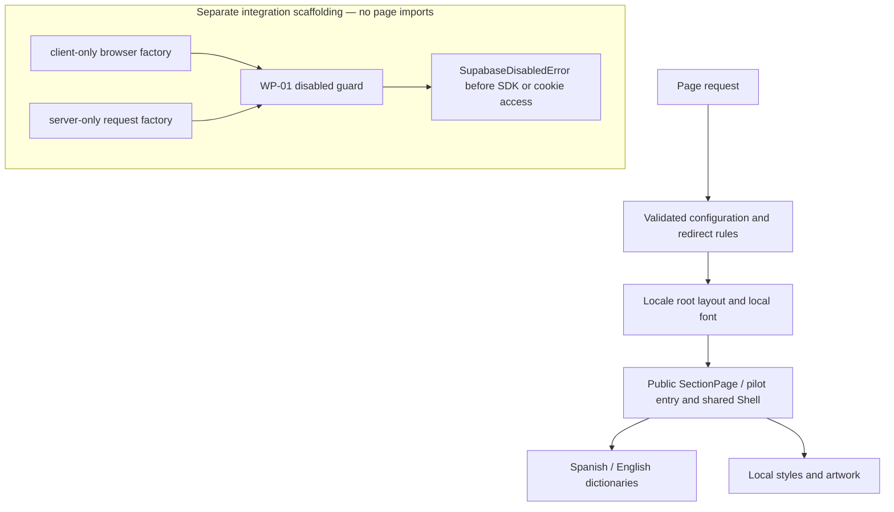

# Foundation architecture

## Runtime and source layout

This is one Next.js App Router application with strict TypeScript, pnpm, ESLint, and
Prettier. Server Components are the default. There are no business APIs, user stores,
live sessions, or database-backed pages.

| Location                                                                                                                                                       | Responsibility                                                                                |
| -------------------------------------------------------------------------------------------------------------------------------------------------------------- | --------------------------------------------------------------------------------------------- |
| [next.config.ts](../next.config.ts)                                                                                                                            | Environment validation, Spanish-default redirects, response headers.                          |
| [Locale layout](../src/app/%5Blocale%5D/layout.tsx)                                                                                                            | HTML language, translated metadata, local Roboto font, static locale generation.              |
| [Public route](../src/app/%5Blocale%5D/page.tsx), [HQ route](../src/app/%5Blocale%5D/hq/page.tsx), [streamer route](../src/app/%5Blocale%5D/streamer/page.tsx) | Small entry points selecting the corresponding preview shell.                                 |
| [SectionPage](../src/components/section-page.tsx)                                                                                                              | Localized page composition, real section/route links, public brand-perspective content.       |
| [Shell](../src/components/shell.tsx)                                                                                                                           | Header, wordmark, navigation, language selection, keyboard skip link, footer.                 |
| [UI primitives](../src/components/ui/panel.tsx) and [global styles](../src/app/globals.css)                                                                    | Shared panels, badges, icons, semantic design tokens, responsive/reduced-motion behavior.     |
| [Locale configuration](../src/lib/i18n/config.ts) and [dictionaries](../src/lib/i18n/dictionaries.ts)                                                          | Supported locales, shell paths, checked translation shape and content.                        |
| [Environment modules](../src/lib/env/schema.ts)                                                                                                                | Pure parsing plus explicit public/server accessors. See the environment guide for boundaries. |
| [Supabase guard](../src/lib/supabase/config.ts)                                                                                                                | Rejects client creation throughout WP-01.                                                     |
| [Security headers](../src/lib/security/headers.ts)                                                                                                             | Production content-origin restrictions and other foundation response controls.                |
| [Tests](../tests/unit/environment.test.ts) and [Playwright configuration](../playwright.config.ts)                                                             | Unit/integration coverage and isolated production HTTP/browser tests.                         |

## Routing and rendering

Spanish public/HQ/streamer routes are `/es`, `/es/hq`, and `/es/streamer`; English
equivalents use `/en`. The root, `/hq`, and `/streamer` redirect to Spanish with a
temporary 307 while preserving query parameters. Browser language does not override
the explicit Spanish default. Language links preserve the current shell.

The locale layout generates both supported locales at build time. Unsupported
locales and unknown paths return 404. Shared metadata is localized; each shell is a
preview composition, not a protected route or a functional dashboard.

## Design and assets

Roboto, neutral surfaces, olive typography, and restrained lime accents express the
approved modern talent/livestream/global direction. CSS tokens own shared spacing,
color, radius, and typography. Source artwork is local; the conceptual creator image
does not represent an actual GG's creator or endorsement. See the
[design notes](design-direction.md) for provenance and the exact image prompt.

## Boundary decisions and limits

- Public environment access lists the four intended public fields explicitly so
  Next.js can inline them. Server configuration is marked `server-only`.
- Browser and server Supabase helpers have separate marker packages and no mixed
  barrel export. The server factory is request-scoped, not a shared visitor session.
- The enable flag only accepts `false`. Constructors/cookie handling behind that
  guard are scaffolding, not working authentication. No page invokes the factories.
- Database types are an empty contract. No table, migration, query, RLS policy,
  storage operation, or realtime subscription has been created.
- Production CSP restricts origins and framing but allows inline Next.js bootstrap
  scripts/styles. It is not a nonce-based XSS defense. Device permissions and
  external connections are blocked for the current static foundation.

See [environment details](environment.md), [security scope](../SECURITY.md), and the
[WP-02 handoff](wp-02-handoff.md) before adding integration or private data.

## Decisions deliberately deferred

Hosting, deployment access gates, live Supabase resources, authentication providers,
roles/authorization, database schema, recruitment/onboarding, and other business
features are not selected or implemented by this architecture. Choosing a shell
name does not define a permission model. Approve those decisions in the next work
package before writing implementation code.

## WP-02 first-increment update

HQ and streamer routes now use [PilotEntry](../src/components/pilot-entry.tsx);
[pilot information](../src/components/pilot-information.tsx) provides the localized
`/pilot` and `/access-denied` public states. The shared Shell preserves these page
paths when switching languages. The public landing design remains unchanged.

The [pilot policy model](../src/lib/pilot/policy.ts) is a pure, fixture-tested
contract, not live authentication or route/data enforcement. App pages do not read
test identities, user roles, browser flags, or request cookies. The approved
[first-increment scope and matrix](wp-02-pilot-access.md) records the next gate;
the disconnected Supabase implementation remains unchanged.
